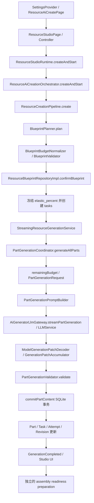
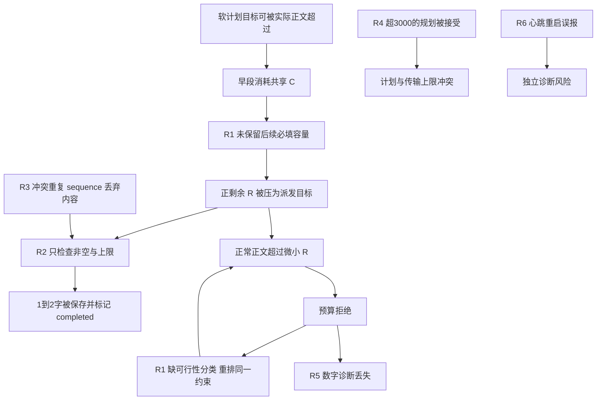

# 角色卡生成预算：根因审计结果与分阶段修复设计

## 1. 文档概述

本文件整理已经完成的独立只读审计，供后续执行 Agent 定位、复现、实施和验收。它是修复设计与证据交接文档，**不是修复完成报告，也不授权立即实施修复**。

| 项目 | 当前事实 |
| --- | --- |
| 项目 / 仓库 | LT Dialogue / `yangrunzhi345-blip/LT` |
| 整理日期 | 2026-10-13 |
| 应用版本 / SQLite schema | `1.2.07+29` / `49` |
| Branch | `main` |
| 审计与本次文档初始 HEAD | `01f6ed029b69015f753751c64ce0e5f95e21bea9` |
| 本地 `origin/main` | 与 HEAD 相同；ahead/behind 为 `0/0`；未 fetch，不能代表即时远端状态 |
| 本次文档任务初始工作区 | `git status --short` 为空，未发现原有未提交修改 |
| 根因调查状态 | AUDIT COMPLETE：关键生产链、确定性缺陷与测试证据已恢复；真实模型质量和部分运行现场仍有未知项 |
| 实现审计裁决 | FAILED：存在 3 项 MAJOR、3 项 MINOR；没有确认的 BLOCKER |
| 本文件状态 | 原审计与设计保留；2026-10-13 局部修复断点见第 15 节，整体未验收 |

### 1.1 范围与权威来源

范围是统一 Resource Studio 的世界观、角色卡、NPC 蓝图 / Part 生成预算、正文完成判定、解析、重试、持久化和相关 UI。冒险正文 L0–L5、压缩算法、历史导入映射、TTS、整个工作台重构均不作为本次修复目标；仅验证受到本子系统变化影响的装配和关联生成边界。

代码是当前事实；[AGENTS.md](../AGENTS.md) 是工作规范；[ADR-0003](architecture/configurable-generation-elasticity.md) 是当前弹性权威。以下文档用于解释历史决策，不能把其旧基线的结论直接套到当前实现：

- [目标硬拒绝与别名重复的历史修复记录](codex/character-generation-budget-regression.md)。其中既有修复要保留。
- [固定 20% 弹性的历史实施规格](codex/character-generation-elastic-budget-deepseek-adaptation.md)。当前已可配置；其“放宽后不会耗尽尾段”结论不能成立，其“4096 token 必然不会截断”断言也不能当作一般保证。
- [可配置弹性的历史检查点](codex/configurable-elasticity-checkpoint.md)。`PAUSED / NOT VERIFIED` 描述当时 WIP，不能推断当前 main 尚未接入。
- [流式 / 原子提交修复计划](post-phase12-remediation/remediation-master-plan.md)、[蓝图阶段](adaptive-resource-system/phase-04-adaptive-blueprint.md)、[增量协议阶段](adaptive-resource-system/phase-05-incremental-json-protocol.md)、[Studio 阶段](adaptive-resource-system/phase-06-streaming-resource-studio.md)。

### 1.2 已恢复证据及限制

本轮完整独立审计尚未落成单独仓库报告；结论存在于本会话的审计上下文和隔离目录。本文优先恢复这些结果，再核对关键源码，没有从零猜测根因。

| 证据编号 | 来源 / 证明范围 |
| --- | --- |
| E-LOG | 用户在会话粘贴的 Linux Flutter 真实日志，含两个资源、自动 / 手动重试与恢复；不是本 Agent 调用 API 得到 |
| E-CODE | 当前 HEAD 的生产源码、DI、SQLite 事务、UI 与 Git 历史 |
| E-TEST | 前一审计在隔离副本执行的 302 个现有测试及静态分析输出，见第 11 节 |
| E-PROBE | 前一审计的 11 个生产链确定性探针和 1 个心跳探针；网络输出可控，Parser / Validator / SQLite 等真实生产实现未替换 |
| E-SCREEN | 用户描述的章节名及“荒”“导师”、独立比例与摘要不同；缺少与日志 Part ID 一一映射的用户数据库证据 |

用户提到的完整原日志文件名为 `粘贴的文本 (1)(2).txt`，**没有在本工作区读取到该原文件**。E-LOG 实际来源是会话粘贴文本；粘贴显示曾有中部截断，不能宣称原文件全量已读取。前一审计生成的预算 CSV 和测试输出仍可读取。本文内嵌关键数字、事件、复现条件，使后续交接不依赖临时目录存活；原始 NDJSON 正文、真实章节标题映射仍标为 UNKNOWN。未读取或修改用户 SQLite 数据库。

临时证据目录为 `/tmp/lt_readonly_audit_qwuwik69/`，不属于仓库正式交付。主要文件：`part-budget-table.csv`、`audit_reproduction_test.dart`、`audit_heartbeat_probe_test.dart`、`probes-final.log`、`duplicate-probe.log`、`heartbeat-probe.log`、`targeted-original-deps.log`、`additional.log`、`migration-retry-ui.log`、`analyze.log`。SHA-256 可帮助核对本机证据：

| 文件 | SHA-256 |
| --- | --- |
| `part-budget-table.csv` | `1c57eaed91f732f123c0e10e8249026eb5a80ef6e0268581f8370cdcae410f6e` |
| `probes-final.log` | `6fe763f04450a6a755f90f2a095a8be340b436c8c30a821b8ecbdb13281bc831` |
| `duplicate-probe.log` | `9c605aa01ea4fd9378485f29618499855445ae89df860bf1269470d8d4cfffb1` |
| `heartbeat-probe.log` | `8c4ac3e2e4859aa2e8305845f6ebc6ffe48c294044f3c8965c8eadf4f5aba677` |

证据等级统一为：CONFIRMED（代码及可复现证据）、PROBABLE（可信但复现链未齐）、HYPOTHESIS（待验证）、DISPROVED（所述假设被排除）、UNKNOWN（资料不足）。等级适用于具体命题，不能把同一 ISSUE 中所有现场猜测一起标成 CONFIRMED。

## 2. 执行摘要

确认的独立缺陷共 **6 项**：P0=0，P1=3，P2=1，P3=2。下文 10 个 ISSUE 是调查主题，不是 10 个不同缺陷；预算耗尽、不可行派发和无效重试共享 R1。ISSUE-02 的当前任务冻结行为不计 Bug；ISSUE-06 是对照分析。

| 根因 | 优先级 / 严重性 | 对应 ISSUE |
| --- | --- | --- |
| R1：共享累计预算未为后续必填 Part 预留有效容量；正剩余量直接成为目标，没有可行性与错误类别门禁 | P1 / MAJOR | 01、04、05 |
| R2：正文完成规则只验证非空、身份和最大长度，缺少按内容类型的最低有效内容契约 | P1 / MAJOR | 03 |
| R3：重复旧 sequence 未比对载荷，冲突正文静默丢弃后仍可完成 | P1 / MAJOR | 07 |
| R4：总规划合法时未检查单 Part 预计长度上界，可接受超过 3000 的计划 | P2 / MINOR | 08 |
| R5：预算错误映射丢失安全数字，提示混淆软目标与总容量，不能指导恢复 | P3 / MINOR | 10 |
| R6：UI 心跳计时器重启复用停止前时间，正常生命周期间隔可误报主 Isolate 阻塞 | P3 / MINOR | 09 |

真实角色卡故障链是：早期正文超过软计划 → 消耗共享上限 → 未保留尾段容量 → 后期请求目标变为 1–4 → 极短正文被接受或正常长度被拒绝 → 重试不改变容量约束。失败不会由提高 `max_tokens` 自动解决；降低 token 上限也不能替代有效内容契约。

用户影响包括：章节“已生成”不代表叙述完整；90% / 95% 可伴随必填章节缺失；失败后继续请求消耗 token；修改独立设置不会解锁旧任务。数据安全的重点是**已保存内容和版本必须继续保留**，不能自动截断、压缩发布、删除短字段或把历史完成状态批量回写。现有 CAS / 原子提交应保留，不应为了让失败任务变绿放宽资源上限。

推荐顺序：先确定内容契约与保护旧数据，修复冲突解析；再建立一致预算快照和规划 / 派发预留；然后接入质量完成规则、错误分类与安全恢复；最后独立处理 UI 说明和诊断，完成跨模块验收。第 10 节将这些依赖拆为六个阶段。

## 3. 系统架构与真实调用链

### 3.1 当前调用顺序

**当前资源管线先规划，后确认并冻结预算，再生成正文。** 不能按逻辑示意把“冻结”误写在 Planner 前：Planner 使用用户 T 规划，确认事务冻结 E，并创建 Part tasks。



图中末段是逻辑依赖：服务会先持久化生成 session completed，尝试装配准备，再发布 GenerationCompleted。准备失败不能把已经成功的正文生成改写成失败。creation session 的 completed 则表示蓝图已确认，与 generation session 的正文完成不同。

### 3.2 源码定位索引

所有链接的 `#L` 行号对应本文件基线；未来应按类名 / 方法名定位，不能只依赖行号。

| 编号 | 文件 / 稳定符号 | 当前职责 |
| --- | --- | --- |
| C01 | [SettingsProvider](../lib/providers/settings_provider.dart#L73) | 全局比例归一化并持久化 `settings` |
| C02 | [ResourceAiCreatePage 创建参数](../lib/features/resource_library/presentation/screens/resource_ai_create_page.dart#L247)、[_effectiveElasticPercent](../lib/features/resource_library/presentation/screens/resource_ai_create_page.dart#L822) | 独立比例或继承；创建前预算预览 |
| C03 | [ResourceStudioPage 创建入口](../lib/features/resource_studio/presentation/pages/resource_studio_page.dart#L212)、[Controller.createAndStart](../lib/features/resource_studio/presentation/controllers/resource_studio_controller.dart#L405)、[Runtime.createAndStart](../lib/features/resource_studio/application/use_cases/resource_studio_runtime.dart#L338) | 直接创建路径透传 E；审阅路径也透传 |
| C04 | [ResourceAiCreationOrchestrator.createAndStart](../lib/features/resource_studio/application/use_cases/resource_ai_creation_orchestrator.dart#L46)、[ResourceCreationOriginEnvelope](../lib/application/resources/resource_creation_contracts.dart#L126) | 保存本次运行选择，编排创建 / 规划 / 确认 |
| C05 | [BlueprintPlanner.plan](../lib/application/resources/blueprint_planner.dart#L64)、[BlueprintPromptBuilder](../lib/application/resources/blueprint_prompt_builder.dart#L39) | T 作为规划总软目标；动态 Parts / Sections |
| C06 | [BlueprintBudgetNormalizer.normalizeToGenerationTarget](../lib/application/resources/blueprint_budget_normalizer.dart#L14)、[BlueprintValidator](../lib/application/resources/blueprint_validator.dart#L185) | 超 T 时按比例归一化；身份 / DAG / 最小预计长度 / 总量 |
| C07 | [ResourceBlueprintRepositoryImpl.confirmBlueprint](../lib/application/resources/resource_blueprint_repository.dart#L215)、[_resolveElasticPercentInTransaction](../lib/application/resources/resource_blueprint_repository.dart#L513) | 确认事务冻结 E、创建正文任务 |
| C08 | [GenerationBudgetPolicy.cumulativeCeiling](../lib/domain/resources/resource_limits.dart#L218) | `C=min(T*(100+E)~/100,A)` |
| C09 | [PartGenerationTaskRepositoryImpl.remainingBudget](../lib/application/resources/resource_generation_task_repository.dart#L421)、[_cumulativeCeilingInTransaction](../lib/application/resources/resource_generation_task_repository.dart#L467) | 冻结预算减其他有效 Part 的实际正文 |
| C10 | [PartGenerationCoordinator.generateAllParts](../lib/application/resources/part_generation_coordinator.dart#L265)、[_generateSinglePart](../lib/application/resources/part_generation_coordinator.dart#L830) | DAG、有限调度、派发、解析、验证、提交 |
| C11 | [PartGenerationRequest.maximumAcceptedCharacters](../lib/domain/resources/resource_generation_protocol.dart#L210)、[PartGenerationPromptBuilder](../lib/application/resources/part_generation_prompt_builder.dart#L53) | 当前 soft target 与硬接受上限 |
| C12 | [AiGeneratorLlmGateway.streamPartGeneration](../lib/application/llm/ai_generator_llm_gateway.dart#L249)、[LlmTaskPolicy Part 配置](../lib/services/llm_task_policy.dart#L108)、[LLMService 完整性处理](../lib/services/llm_service.dart#L421) | 非思考、4096 tokens、SSE；拒绝不完整传输 |
| C13 | [ModelGenerationPatchDecoder](../lib/application/resources/model_generation_patch_decoder.dart#L55)、[GenerationPatchAccumulator.applyPatch](../lib/application/resources/generation_patch_parser.dart#L333) | 客户端绑定身份，NDJSON 累积真实正文 |
| C14 | [PartGenerationValidator.validate](../lib/application/resources/part_generation_validator.dart#L110)、[SectionContentValidator.validate](../lib/domain/resources/section_control.dart#L500) | 非空 / 上限与结构身份；缺少质量契约 |
| C15 | [PartGenerationTaskRepositoryImpl.commitPartContent](../lib/application/resources/resource_generation_task_repository.dart#L485) | CAS、累计量复核、正文 / Task / Attempt / Revision 原子写入 |
| C16 | [StreamingResourceGenerationService 完成路径](../lib/application/resources/streaming_resource_generation_service.dart#L542)、[resumeGeneration](../lib/application/resources/streaming_resource_generation_service.dart#L660) | 生成状态与装配准备分离；恢复重新开启调度 pass |
| C17 | [Controller.setElasticOverride](../lib/features/resource_studio/presentation/controllers/resource_studio_controller.dart#L123)、[ResourceCreationPipeline.resolveSessionElasticPercent](../lib/application/resources/resource_creation_pipeline.dart#L601) | 设置资源 override；预算显示仍读取任务快照 |
| C18 | [Studio 预算摘要](../lib/features/resource_studio/presentation/pages/resource_studio_page.dart#L1716)、[Outline 状态](../lib/features/resource_studio/presentation/widgets/resource_studio_outline.dart#L161) | 显示有效 E、已保存 / 预览、按 Task completed 显示已生成 |
| C19 | [生产 DI](../lib/providers/riverpod_providers.dart#L559) | 注入真实 Repository / Gateway；当前正文 coordinator 并发为 1 |
| C20 | [GenerationDiagnostics.startUiHeartbeat / stopUiHeartbeat](../lib/core/debug/generation_diagnostics.dart#L137) | UI timer 和 runtime heartbeat 是不同诊断信号 |
| C21 | [resourceGenerationError](../lib/application/resources/resource_generation_error.dart#L20)、[AppErrorCode](../lib/domain/errors/app_error.dart) | 失败投影为安全错误码 |
| C22 | [PartContentCommitService 手动保存](../lib/application/resources/part_content_commit_service.dart#L160)、[reopenCompletedTasksInTransaction](../lib/application/resources/resource_generation_task_repository.dart#L696) | 手动改完成 Part 后重开 task；恢复方案须考虑这个行为 |

## 4. 问题清单与复现证据

### ISSUE-01：角色卡正文超出软规划，累计容量提前耗尽

**优先级：** P1 / MAJOR（R1）。**状态：** CONFIRMED；“频繁”的统计频率 UNKNOWN，仅有本次完整可识别失败资源，不能从重复 Dump 算复现次数。

**问题描述 / 触发条件：** T=10,000，E=20%，C=12,000，20 个 Part 计划合计 9,800。多个早期 Part 超计划但未超过当前 R 和 3000，均可提交。依赖有序执行不等于容量可完成。

**预期行为：** 超出单段软目标可以合理接受，但接受早段之前必须确保剩余必填内容仍有有效容量；不可满足时停止请求并给出受保护的恢复入口。

**实际行为 / 根因：** 前 14 次成功提交对应计划 7,000，实际 11,178（+59.7%），剩余 822；尚未完成的六个 Part 计划合计 2,800。没有预留，后续被迫请求几十字乃至 1–4 字。预算算式和总上限没有失效，失败来自分配机制缺失。

**代码证据：** C09 只做 C 减其他已保存正文；C10 的 `_generateSinglePart` 在 [988 行](../lib/application/resources/part_generation_coordinator.dart#L988) 仅在 R≤0 停止，R>0 则 `min(estimatedLength,R)`；C14 接受条件不限制实际正文必须贴近计划；C15 提交复核同一总上限。

**运行时证据：** 第 4.11 节预算表 / 时间线。E-PROBE 用同一生产 coordinator 与 SQLite，20×500 计划，前 17 段各 667、第 18 段 659、第 19 段 1、第 20 段 2，最终 19/20、11,999/12,000，最后两次请求剩余 1 均失败。分别以 character 和 worldview 执行，均复现。

**影响范围：** 两类资源与 NPC 共用管线；已保存正文保留，但整体资源不完整、用户难以通过再次重试恢复。**建议解决方案：** 第 6.2 节的类型最小预算、按剩余目标分配与事务预留保护；不能只提高 E。**潜在副作用：** 限制早段自然展开可能提高局部重试率，必须向模型传清楚本段允许值并保持原文 / 修订。**回归测试：** T07–T12、T24。**验收标准：** 新任务不会消耗后续必填最低容量；真实生产链可控超计划输入能完成或明确不可行，不能落入 1 字尾段调用。

### ISSUE-02：独立设置 50%，当前摘要仍是 20%

**优先级：** P3 / INFO（不计确认缺陷）。**状态：** DISPROVED 适用于“当前 main 完全未接入弹性”和“确认后修改设置应自动扩大旧任务”这两个假设；实际用户是否创建前选了 50% 为 UNKNOWN。

**问题描述 / 触发条件：** 已确认任务冻结为 20%，之后在 Studio 改资源 override 为 50%，再恢复同一任务。**预期行为：** 根据 ADR-0003，旧任务仍按 20%，新任务按确认时优先级解析。**实际行为：** metadata 更新、UI 重载，但 `resolveSessionElasticPercent` 在 confirmed 分支读冻结列，不读新 override。

**根因分析 / 代码证据：** C17、C07、C09、C18 使用不同语义的配置值，行为一致。确认优先级为：本次运行 origin 显式值 → 目标资源持久 override → 全局 settings → 默认 20；参考世界观不参与继承。历史 `elastic_percent=NULL` 固定解析为 20%。Planner（C05）读取 T 规划，E 通过 origin 进入确认阶段，并通过 R / 接受上限影响正文请求；不是将 Planner 总计划改成 C。

**运行时证据：** 世界观 T20,000 / C24,000，角色卡 T10,000 / C12,000，已超过 T 的正文可成功提交，说明 20% 在真实运行起作用。E-PROBE 验证全局20 / 显式50→冻结50，全局50 / 显式20→20，全局50 / 继承→50，确认后全局改0快照不变。没有真实日志证明用户新建时选择50却冻结20。

**影响范围：** 现有 UI 容易让失败任务的用户期待即时调大预算。**建议解决方案：** 明确标识“后续任务设置”和“当前冻结预算”；新建 10,000 / E50 的上限必须显示15,000。若需要变更失败任务，设计显式的新预算执行版本，见第6.5节；不能静默改老蓝图。**潜在副作用：** 错把现有冻结语义当 bug 修复会让运行与提交预算漂移。**回归测试：** T01–T06、T22。**验收标准：** 两种值展示清楚且与 SQLite 同源；创建前 E50 在直接 / 审阅两路均进入真实确认事务；旧任务不追溯。

绝对容量仍限制弹性：character T20,000 时 E20 和 E50 都最多24,000；worldview T20,000 / E50 可到30,000。这类上限不变是正确截顶。规划和目标字数不随 E 改变，也是当前设计，不代表未接入。

历史曾有直接创建路径漏传 E 的真实缺陷，`f51d4b9de13517bcdd872174310aa91b5bcec3d0` 已在当前 main。旧客户端或旧任务可能受到历史问题影响，但无法从本次日志确认其创建所用 commit。

### ISSUE-03：1–2 字叙述性正文通过验证并持久化为 completed

**优先级：** P1 / MAJOR（R2）。**状态：** CONFIRMED；真实日志短内容的精确文字、章节名及原始 wire 内容仍 UNKNOWN。

**问题描述 / 触发条件：** 身份合法、协议收到 complete_part、正文非空、长度≤3000且≤当前剩余容量。即使预计450–500，只返回1–2也满足当前检查。**预期行为：** 叙述章节必须满足其内容契约；合法短标量字段可以1–2字完成，不得统一按100字拒绝。

**实际行为 / 根因分析：** C14 仅有 `trim().isEmpty`、3000及最大接受量校验；身份 / allowlist / 树结构正确不等于正文有效。`complete_part` 是模型的结束声明，不是章节质量证明。SectionContentValidator 同样只做非空 / 最大长度；Task completed 进入 UI“已生成”，总体进度按 completed 数量计算。

**代码证据：** [PartGenerationValidator](../lib/application/resources/part_generation_validator.dart#L110)、[Accumulator.toResponse](../lib/application/resources/generation_patch_parser.dart#L423)、[commitPartContent 完成写入](../lib/application/resources/resource_generation_task_repository.dart#L649)、C18。

**运行时证据：** 第4.12节真实提交链。E-PROBE 在容量充足、目标1000时，分别返回“荒” / “导师”，真实 SQLite 保存且 generation 成功；这证明短完成缺陷独立于预算耗尽。探针使用的章节名是人为 fixture，**不证明真实日志对应章节就是用户截图那两个标题**。

**影响范围：** 语义残缺可持久化，并在恢复时因已 completed 被跳过；装配的结构 / 容量检查不能充分证明叙述完整。**建议解决方案：** 第6.1、6.3、8节类型契约与校验结果，受保护地检测历史可疑内容。**潜在副作用：** 误杀姓名、关系标签等合法短字段；过严长度可能迫使凑字。**回归测试：** T13–T17、T23。**验收标准：** 大容量时1–2字叙述仍不能完成；类型允许的短字段能完成；历史短内容只标可疑，不自动删除或替换。

### ISSUE-04：规划总量合法，但派发目标不可满足章节

**优先级：** P1 / MAJOR（R1，与01共享根因）。**状态：** CONFIRMED。

**问题描述 / 触发条件：** 必填叙述 Part 预计450–500，实际 R=4、2、1。**预期行为：** 检查当前最低有效需求和所有后续必填保留量，不能把“还可存一个字符”当成“还可生成完整章节”。**实际行为：** R正即继续；`targetCharacters` 被压为R，`maximumAcceptedCharacters=min(R,3000)`。

**根因分析 / 代码证据：** C06 只有规划最小预计10和总量规则；模型动态选择6 Sections / 20 Parts，没有固定“角色卡必须20”的规则。C09 / C10 没有未来 reserve 或动态目标重分配。最初9,800≤T10,000是可容纳的计划，并非仅凭Part数量就不可行；不可行性在早段偏差积累后产生。

**运行时证据：** `part_16: estimatedLength450,targetCharacters6,body2`；`part_20:450,4,body5失败`；`part_6:450,1,body1052失败`。**影响范围：** 创建、自动恢复和手动重试共用此逻辑。**建议解决方案：** 第6.2 / 7节明确 `dispatchableBudget` 与失败诊断；变更目标只能改未生成规划元数据，不能裁剪正文。**潜在副作用：** 旧计划无内容契约，不能未经判断将全体历史任务新规则化。**回归测试：** T08–T12、T19。**验收标准：** R=4/2/1 且最低需求更高时，生成 / 手动重试 / 恢复均0模型调用，给出相同不可行原因。

### ISSUE-05：不可满足预算被按普通失败反复重试

**优先级：** P1 / MAJOR（R1后果，不另计根因）。**状态：** CONFIRMED。

**问题描述 / 触发条件：** 多次失败仍保留不变的R和冻结C。**预期行为：** 区分有容量但模型偶发超长与容量不足；后者在约束变化前不再请求。**实际行为：** 自动循环对failed且非sourceConflict的任务 markReady，只看本pass剩余重试次数；手动retrySinglePart、resumeGeneration重新进入相同预算计算。

**根因分析 / 代码证据：** [自动预算](../lib/application/resources/part_generation_coordinator.dart#L326)、[failed重排](../lib/application/resources/part_generation_coordinator.dart#L655)、[retrySinglePart](../lib/application/resources/part_generation_coordinator.dart#L775)、C16、C21。默认每pass3次（1+maxRetries2），派发前扣次数，已有无限循环修复有效；新pass重置该pass allowance，SQLite attempt_number持续递增。手动单次本身没有内层3次循环。

**运行时证据：** part6实际剩1，却在attempt5/6/7分别生成1052/2078/1200并全拒绝；此前attempt1–4也失败。**影响范围：** 不必要token消耗、等待、错误提示，原正文仍保留。**建议解决方案：** 第6.4 / 9节失败分类，预检结果为stopUntilConstraintsChange，manual / resume共用guard。**潜在副作用：** 将全部预算错误不可重试会误拒绝“容量充足但模型本次超长”的可恢复失败。**回归测试：** T18–T21、T25。**验收标准：** 不可行情况下没有API请求或新自动重排；可行超长仍有限纠正；错误原因、attempt与旧正文可追溯。

### ISSUE-06：同样分级生成，世界观成功而角色卡失败

**优先级：** INFO（比较主题）。**状态：** CONFIRMED 两个案例的数值与共用管线；“角色卡先天必败” DISPROVED，引用导致更长输出 HYPOTHESIS。

**问题描述 / 触发条件：** 比较两个用户资源，而非假定资源类型选择了不同Validator。**预期行为：** 同一预算 / 内容契约在两种资源中遵循同一不变量。**实际行为：** 下表显示规划相对C的空间很不同。

| 项目 | 世界观 | 角色卡 |
| --- | --- | --- |
| T / E / C | 20,000 / 20% / 24,000 | 10,000 / 20% / 12,000 |
| Sections / Parts / 计划P | 4 / 16 / 14,800 | 6 / 20 / 9,800 |
| 相对P的余量 `(C-P)/P` | 62.2% | 22.4% |
| 最后已保存 / 完成数 | 22,910 / 16 | 11,999 / 19，另1失败 |
| 相对P实际偏差 | +54.8% | 总量+22.4%，但包括被压为极短的尾段 |
| 对用户T偏差 | +14.55% | +19.99% |

世界观16段都超过各自计划，但总量仍在24,000内。角色卡前14段就比对应计划多59.7%，因此先失去尾段容量。E是相对T的比例，不是每段计划的扩写许可证。

**根因分析 / 代码证据：** C05按resourceType改变提示的资源语义，由模型动态规划；C10–C16的调度、Prompt构造、Parser、Validator、完成、错误恢复与SQLite共用。绝对A和目标T不同；没有证据说明角色卡独享更严格的正文上限。worldview参考216；character引用23762，单段选摘和依赖上下文有界，但其对输出风格的影响尚未量化。

**运行时证据：** E-PROBE以相同T10,000和20段数据对两类均造成尾段失败；另用T20,000、20段合计22,910，两类均完成。**影响范围 / 建议解决方案：** R1/R2共享修复，加入两类对照；不能只给角色卡无限扩容或降低必填要求。**潜在副作用：** 类型特定契约应允许世界设定与人物关系不同内容结构。**回归测试：** T24、T27、T28。**验收标准：** 两类在相同边界条件下表现一致，并保留各自目标 / 绝对容量与关联规则。

### ISSUE-07：冲突重复 sequence 静默丢弃正文

**优先级：** P1 / MAJOR（R3）。**状态：** CONFIRMED 独立确定性缺陷；本次真实短正文是否由它造成 UNKNOWN。

**问题描述 / 触发条件：** 同一attempt先append sequence1“荒”，再收到sequence1不同长正文，随后sequence2 complete。**预期行为：** 相同载荷重放无副作用；不同载荷同序号必须显式协议失败，不能选一份静默继续。

**实际行为 / 根因 / 代码证据：** C13 [350行](../lib/application/resources/generation_patch_parser.dart#L350) 在比cursor / payload前直接对`sequence<nextSequence` return，没有保存已应用内容的指纹。E-PROBE脚本将`'本应保留的完整历史与关系正文' * 30`作为冲突append，共420 UTF-16单位，真实SQLite只保存“荒”并completed。

**运行时证据：** `duplicate-probe.log`独立复跑PASS；早期`probes-final.log`诊断字符串曾错误写“480”，不采用该数字，以已纠正脚本、420实际长度与复跑为准。正常SSE分块拼接不做按预算截断；协议wire比body长本身不构成丢失证据。

**影响范围：** 所有流式Part；即使质量阈值提高也应修复静默冲突。**建议解决方案：** 第6.3的重复事件规范比较 / 显式异常。**潜在副作用：** JSON键顺序、可选cursor等等价表示不能误判冲突；相同终止marker重放仍幂等。**回归测试：** T16、T17、T26。**验收标准：** 冲突不写正文、不completed；相同重复只追加一次；混合Unicode、断行和最后flush仍完整。

### ISSUE-08：总规划合法时单 Part 可超过3000传输上限

**优先级：** P2 / MINOR（R4）。**状态：** CONFIRMED；非本次450–600计划的直接根因。

**问题描述 / 触发条件：** T10,000、唯一Part估计10,000、规划总量=T。**预期行为：** 在确认前拒绝或重新规划为授权的小Parts。**实际行为 / 根因 / 代码证据：** C06 normalizer总量≤T提前返回；BlueprintValidator只查估计≥10，没有估计≤3000。E-PROBE normalizer+validator接受10,000，后续请求最多接受3000。

**运行时证据：** `PROBE planner: accepted estimatedLength=10000 while transport cap=3000`。**影响范围：** 少Part大计划自相矛盾，模型难以完成。**建议解决方案：** 第6.2对所有分支校验 `m≤p≤3000`，必要时在未确认蓝图阶段使用客户端ID池重规划，不在生成中让模型自行新增结构。**潜在副作用：** 修正Part结构需重新校验依赖和映射。**回归测试：** T12。**验收标准：** 不能确认目标超过硬传输上限的Part；没有偷偷提高3000或切掉正文。

### ISSUE-09：STALL与UI心跳信号需要分开解释

**优先级：** P3 / MINOR仅针对R6；STALL语义澄清为INFO。**状态：** CONFIRMED生命周期误报；真实26秒间隔的具体原因 UNKNOWN。

**问题描述 / 触发条件：** UI heartbeat启动产生tick，停止超过4×interval后重新启动。**预期行为：** 停止期间不计主线程活跃监测；STALL应能区分等流式输出和无进展。**实际行为 / 根因 / 代码证据：** C20 stop只取消timer，没有重置上一tick；start复用旧时间。异步探针interval20ms、停止150ms，重启后报告198.8ms GAP且文字断言主Isolate blocked，并没有同步阻塞。

**运行时证据：** 实际PART_TRANSITION_STALL在约10秒触发时，runtimeHeartbeat stage仍为part.sseChunk，age约8–60ms，UI在正常tick；随后LLM DONE、校验与提交完成。C10 [488行](../lib/application/resources/part_generation_coordinator.dart#L488) 每调度循环arm固定watchdog，长于阈值的inflight也触发。task显示validating是因为 [1040行](../lib/application/resources/part_generation_coordinator.dart#L1040) 在请求前recordValidating，不是验证计算持续10秒。

真实26,041.7ms UI gap出现在约+495885ms，而角色卡创建约+495697ms；间隔的大部分早于该创建。另一8,201ms gap时activeRuns为空。局部统计resolveReference1.8ms、pipeline13.9ms、index0.6ms、excerpt最大1.3ms、DB写最大18.1ms，没有证明这些步骤占用了26秒。可能的生命周期停止只能说明误报机制可发生，不能替代现场归因。

**影响范围：** 诊断误导，不证明预算失败引发死锁。**建议解决方案：** 第6.6重置0→1 owner监测基线，标识可观测状态；先复核UI生命周期再做CPU优化。**潜在副作用：** 不应隐藏活跃运行期间的真实卡顿。**回归测试：** T29、T30。**验收标准：** 停止 / 重启无假阻塞；活跃timer实际延迟仍报警；正常长流式请求不被标为确认死锁。

### ISSUE-10：预算错误失去数字上下文，提示误导恢复

**优先级：** P3 / MINOR（R5）。**状态：** CONFIRMED。

**问题描述 / 触发条件：** 验证异常有expected≤1、actual1052等数字；映射给UI后只留下resourceGenerationBudgetExceeded。**预期行为：** 告知当前冻结预算、剩余有效容量、未完成数量和推荐动作，不能泄漏原始正文或凭证。**实际行为 / 根因 / 代码证据：** C21仅返回`AppDomainError(code: code)`；[中文文案](../lib/l10n/app_zh.arb#L3968)写“资源或本段预算，请减少本段字数后重试”，用户可能以为单段软目标是硬拒绝，且尾段仅剩1字根本无法由减字恢复。

**运行时证据：** E-LOG验证失败有精确数字，ATTEMPT_FAILED只显示领域code。**影响范围：** 失败提示、诊断与用户重试行为。**建议解决方案：** 第6.4安全结构化诊断，区分预算不可行和本次输出过长；沿用本地化错误架构。**潜在副作用：** 不能恢复为传递原始异常字符串或整段Prompt。**回归测试：** T18、T21、T22。**验收标准：** 数字同源、动作可行、无原文 / 密钥泄漏。

### 4.11 REAL LOG EVIDENCE / PART BUDGET TABLE / BUDGET EXHAUSTION TIMELINE

运行环境为Linux x64，`flutter run -d linux --no-enable-impeller`；provider DeepSeek、model deepseek-flash、thinking disabled、正文max_tokens4096、SSE+NDJSON。事件按`resourceId + partId + attemptId + stage`去重；Dump里重复历史marker不是新调用。

世界观资源为`res_cre_1791876030593084_1`，generation session为`gen_cre_1791876030593084_1`。+261151ms开始创建，规划约11.2s，+272424ms开始Part；+451876.7ms发布GENERATION_COMPLETED_EVENT，随后RUN_SETTLED。唯一成功提交按执行顺序如下：

| Part后缀 | 计划 / 请求目标 | 提交正文 |
| --- | --- | --- |
| 1 | 800 | 1084 |
| 9 | 800 | 1427 |
| 10 | 1000 | 1639 |
| 2 | 900 | 1613 |
| 5 | 1100 | 1726 |
| 6 | 1000 | 2028 |
| 11 | 900 | 1238 |
| 3 | 1000 | 1498 |
| 7 | 1000 | 1430 |
| 15 | 1100 | 1502 |
| 12 | 900 | 1781 |
| 4 | 700 | 966 |
| 8 | 900 | 1507 |
| 13 | 900 | 1461 |
| 14 | 1000 | 1080 |
| 16 | 800 | 930 |
| 合计 | 14800 | 22910 |

角色卡资源为`res_cre_1791876265118967_2`，generation session为`gen_cre_1791876265118967_2`。下表Part ID均为该resourceId加`_part_N`；章节名全部UNKNOWN（粘贴日志不带蓝图标题，未读取用户库）。数组按持久化attempt顺序，正文长度指模型内容经生产Parser累积后的`accumulatedLength` / `VALIDATION_BEGIN chars`，不是wireContentChars。提交字数为最终保存长度，不把失败输出加入累计。累计和R取成功提交后的时间点，因此按ID排列的累计不单调。

| Part | 计划 | 各次实际请求目标 | 各次正文长度 | 各次验证 | 提交 | 提交时累计 | 提交后R | 重试数 | 最终状态 | 保存相对计划偏差 |
| --- | --- | --- | --- | --- | --- | --- | --- | --- | --- | --- |
| 1 | 500 | 500 | 1004 | PASS | 1004 | 1004 | 10996 | 0 | completed | +100.8% |
| 2 | 500 | 500 | 692 | PASS | 692 | 3507 | 8493 | 0 | completed | +38.4% |
| 3 | 450 | 450 | 655 | PASS | 655 | 5994 | 6006 | 0 | completed | +45.6% |
| 4 | 500 | 500 | 920 | PASS | 920 | 1924 | 10076 | 0 | completed | +84.0% |
| 5 | 500 | 500 | 773 | PASS | 773 | 4280 | 7720 | 0 | completed | +54.6% |
| 6 | 450 | 59,4,2,2,1,1,1 | 84,14,27,14,1052,2078,1200 | 全FAIL | 0 | 无提交 | 最终1 | 6 | failed | 不适用：未提交 |
| 7 | 500 | 500 | 891 | PASS | 891 | 2815 | 9185 | 0 | completed | +78.2% |
| 8 | 600 | 600 | 1059 | PASS | 1059 | 5339 | 6661 | 0 | completed | +76.5% |
| 9 | 450 | 59 | 53 | PASS | 53 | 11994 | 6 | 0 | completed | −88.2% |
| 10 | 500 | 500 | 907 | PASS | 907 | 6901 | 5099 | 0 | completed | +81.4% |
| 11 | 550 | 550 | 762 | PASS | 762 | 8241 | 3759 | 0 | completed | +38.5% |
| 12 | 500 | 500 | 646 | PASS | 646 | 9561 | 2439 | 0 | completed | +29.2% |
| 13 | 500 | 500 | 578 | PASS | 578 | 7479 | 4521 | 0 | completed | +15.6% |
| 14 | 450 | 450 | 674 | PASS | 674 | 8915 | 3085 | 0 | completed | +49.8% |
| 15 | 500 | 500,4,2,2 | 833,5,5,1 | FAIL,FAIL,FAIL,PASS | 1 | 11999 | 1 | 3 | completed | −99.8% |
| 16 | 450 | 6 | 2 | PASS | 2 | 11996 | 4 | 0 | completed | −99.6% |
| 17 | 450 | 450 | 672 | PASS | 672 | 10233 | 1767 | 0 | completed | +49.3% |
| 18 | 500 | 500 | 945 | PASS | 945 | 11178 | 822 | 0 | completed | +89.0% |
| 19 | 500 | 500 | 763 | PASS | 763 | 11941 | 59 | 0 | completed | +52.6% |
| 20 | 450 | 4,4 | 5,2 | FAIL,PASS | 2 | 11998 | 2 | 1 | completed | −99.6% |
| 合计 | 9800 | 30次调用 | 失败正文不计保存 | 19次成功 / 11次失败 | 11999 | 11999 | 1 | 10次额外尝试 | 19/20 | +22.4%（含极短尾段） |

额外尝试数是30调用减20个首次尝试，为10；其中自动重排、手动、恢复混合，不是10次同一自动循环。每段偏差可由提交 / 计划计算：前14个成功段均超计划，正常15段（加part19）亦均超计划；part9为−88.2%，part16/20为−99.6%，part15为−99.8%；part6没有保存正文，不把失败长度当成提交偏差。

| 按提交顺序的节点 | 累计S | R | 当时含义 |
| --- | --- | --- | --- |
| 起点 | 0 | 12000 | 所有20段未完成 |
| p1,p4,p7,p2,p5,p8,p3 | 5994 | 6006 | 已7段 |
| p10,p13,p11,p14,p12 | 9561 | 2439 | 已12段 |
| p17 | 10233 | 1767 | 已13段 |
| p18 | 11178 | 822 | 已14段；余6段计划2800 |
| p15 attempt1 | 不变 | 822 | 833拒绝，不写正文 |
| p19 | 11941 | 59 | 已15段 |
| p6 attempt1 | 不变 | 59 | 84拒绝 |
| p9 | 11994 | 6 | 已16段；仅53字 |
| p16 | 11996 | 4 | 已17段；仅2字 |
| p20 attempt1,p15 attempt2,p6 attempt2 | 不变 | 4 | 5、5、14拒绝 |
| p20 attempt2 | 11998 | 2 | 已18段，90%；仅2字 |
| p15 attempt3,p6 attempt3 | 不变 | 2 | 5、27拒绝；+649212ms RUN_FAILED_MAX_RETRIES |
| 手动p6 attempt4 | 不变 | 2 | 14拒绝 |
| 手动p15 attempt4 | 11999 | 1 | +822286.6ms DB写完，已19段，95%；仅1字 |
| 恢复p6 attempt5/6/7 | 不变 | 1 | 1052/2078/1200拒绝；+1200584.8ms再次失败 |

90% / 95%是18/20、19/20完成任务比率，不是正文质量或目标字数完成率。仍余容量也不能证明整体内容完整。

### 4.12 SHORT CONTENT COMMIT PROOF

真实日志的短正文事件去重后如下；时间为应用诊断相对启动毫秒，不是各次请求耗时：

| Part / attempt | 响应结束与累积 | 校验 | SQLite / 完成 |
| --- | --- | --- | --- |
| p16 / 1 | +637009.8 STREAM_RETURNED；seq2 complete_part；accumulatedLength2 | +637010.2 chars2；+637011.4 passed true | +637022.6 DB_PART_WRITE_END；PART_COMPLETED_EVENT chars2；COMMIT_END |
| p20 / 2 | +644986.9 STREAM_RETURNED；seq2 complete_part；accumulatedLength2 | +644987.3 chars2；+644988.4 passed true | +644999.4 DB_PART_WRITE_END；PART_COMPLETED_EVENT chars2；COMMIT_END |
| p15 / 4（手动） | +822268.3 STREAM_RETURNED；seq2 complete_part；accumulatedLength1 | +822268.6 chars1；+822270.3 passed true | +822286.6 DB_PART_WRITE_END；+822287.1 COMMIT_END |

LLM均finishReason stop / doneMarker true，非只输出reasoning。上述证明客户端**解析出的短正文**完成验证和写库，不是UI展示截断。原始模型到底返回哪个词、是否含冲突seq，需要原wire或用户只读数据才能确认；不能据此证明所有模型正文都完整提取。C13普通分块完整累积、C15写入`response.content`不截断、E-PROBE足以确认短接受规则；R3另有独立丢正文机制，但没有真实日志载荷证明它在这三次发生。

### 4.13 RETRY COST ANALYSIS / SCHEDULER AND HEARTBEAT ANALYSIS

角色卡30次独立Part请求包括：第一轮自动25次、后续手动2次、恢复3次。19次提交、11次因预算拒绝。被拒绝的usage.completionTokens分别为757、135、57、63、55、69、74、63、876、1448、857，合计**4454**；这是服务返回计量，不是估算费用，不包含未完整核实的prompt / 缓存 / 定价费用。不能编造人民币或美元金额。

前期R822 / 输出833属于可能通过重新分配或有限缩写恢复的约束；后期叙述必填只余1–2，重复请求在没有外部约束变更时可避免。固定4096是任务策略token上限，不由字符R推导，NDJSON包装也占token。它不是本次根因：不能把UTF-16单位直接当token，也不能以常见汉字平均比率保证任意语言 / 协议都不截断。

调度watchdog与heartbeat结论见ISSUE-09。记录中不存在已确认死锁。大型参考资料对Prompt风格、真实设备帧卡顿和GC的影响需要独立现场分析，不能扩大本次预算修复范围。

## 5. 根因因果关系与回归历史

### 5.1 已成立的因果链



R3→短正文是确定性探针证明的可能路径，**并未证明发生于真实资源**。R6与预算失败没有确认因果关系。早段超软目标本身是允许行为，不应全部变成违规；缺陷是接受这种偏差时没有预留和反馈。引用长度较大可能影响生成偏差，但没有对照实验证明，属于HYPOTHESIS。

### 5.2 历史与当前回归边界

| Commit | 已核对的变化 / 本次解释 |
| --- | --- |
| `27a0498`（2026-09-16） | 初版Part验证已有非空 / 上限，没有正文语义最低要求；R2是旧缺陷 |
| `ff5c8b6`（2026-09-16） | 旧sequence重复直接忽略；R3是旧缺陷，不归因于可调弹性 |
| `7c2d7d9b3b81c2e6ca955bc49325c2551844bb99` | 2026-10-10加入累计目标硬守卫和Part目标硬拒绝；后者已被后续修复 |
| `c155b9e97f9df46ef76b3b9f25d9a54e6a0d7172` | 2026-10-10将Part目标恢复soft，接受边界改为剩余量 / 3000，并修复卡片alias重复；保留修复，但承认没有reserve的共享池可被早段消耗 |
| `cab3bf1d2ef6235c0c5c78b4e26785b3bba8f8ad` | 2026-10-11加入固定20%的C，只增加容量，没有消除R1；提交描述“cannot starve tail”被本次证据否定 |
| `9dac7f8` | 可调弹性、v49快照、设置和UI检查点；当前不仅是该WIP状态 |
| `f51d4b9de13517bcdd872174310aa91b5bcec3d0` | 2026-10-12修复直接创建路径漏传E，增加冻结与恢复矩阵；已包含于当前main |
| `88a2dd7` | PR6合入main；不等于证明真实模型质量已经验收 |

上述简称SHA均为本地实际存在的提交。无需因发现本次问题撤销旧安全引用裁剪、alias去重、body与optimization状态分离、有限调度、CAS / 原子写入等修复。

## 6. 解决方案详细设计（未来实现，不是当前行为）

### 6.1 先定义按内容类型的完成契约

现有`BlueprintPart`只有标题、generationGoal、estimatedLength和dependencies，无法可靠区分“完整历史叙述”与“一个关系标签”。增加最少的、由客户端确认的内容契约；不能根据标题包含某关键词就推断类型，也不能让模型只报告“已覆盖”便信任它。

建议在`resource_blueprint.dart`的BlueprintPart及`blueprint_parser.dart`存储序列化添加可选、带版本的`contentRequirements`对象：

| 建议字段 | 职责 / 边界 |
| --- | --- |
| `version` | 明确新验证语义；缺省代表legacy未知契约，不能追溯重写旧正文 |
| `kind` | `narrative`、`scalar`、`structured`；使用Dart enum和稳定storage值 |
| `required` | 默认新任务Part必填；仅审阅认可的可选Part可不参与最低保留 |
| `minimumCharacters` | 本Part最低可接受正文计量，用于reserve和确定性长度过滤；不是语义完整的充分条件 |
| `validationProfile` | 客户端受控profile标识，匹配固定结构 / 字段规则；禁止任意执行模型提供规则 |
| `requiredFields` | 仅structured profile需要，服务器模型不能随意扩展字段权威 |

原格式`blueprint_json`可存可选对象，初步不需要新增SQL列；更新parse/serialize/copyWith/equality、Planner提示及BlueprintValidator allowlist。新增profile应复用既有结构化字段规则能满足的部分，不新建并行资源体系。模型建议type/minimum需客户端profile校验、规划预览确认和可行性校验后冻结，不能任其填minimum=1规避规则。

对于narrative，策略必须把计划450–500的完整叙述映射为大于1–2的最低可用量，并约束必要内容结构；scalar可以minimum1。具体profile阈值和语义覆盖要求需要Phase1产品确认，本文不把任意固定100或任意比例宣称为现有规则。实施接口必须允许注入已确认profile；测试可明确输入`narrative minimum=180,plan=450`及`scalar minimum=1`，证明区分和预留机制，不用这种fixture数值冒充最终产品阈值。

把规则集中在领域纯函数或现有Validator的受控profile分派，供生成验证、Section验证和显式修复审阅复用。仅新生成任务先使用严格契约；用户手写 / 导入的短文本不被自动删除。历史任务无类型契约时返回`needsContentReview`建议，不批量猜测为narrative。若现有资源模板能给可靠类型则可制定明确legacy适配规则，必须单独测试。

### 6.2 建立单一预算分配结果，并在提交内保护预留

修改C06让所有规划分支检查单Part上界及契约可行性。将已有`IPartGenerationBudgetReader`扩展为读取一次数据库一致状态并返回类型化的分配结果，而不是只返回int R；现有剩余查询、C公式和计量复用。建议结果包括：冻结E/C、当前Part旧正文量、其他已保存S、未完成集合、reserve、current minimum、recommendedTarget、acceptedMaximum、constraint fingerprint、feasible / reason。不要在Prompt、UI和Commit各自复制公式。

具体算法见第7节。recommendedTarget按未完成规划权重重新分配R；acceptedMaximum不再让本段独享整个R，而是至少扣除其他必填最低预留。`PartGenerationRequest`增加显式acceptedMaximum及内容契约，maximumAcceptedCharacters消费授权最大量，保留3000；PromptBuilder同时说明软目标、该段硬最大及minimum / profile需求。`remainingResourceBudget`仍表示真实资源R，不能把reserve后D伪装成R。

预检不可行时在调用gateway前终止，记录安全失败原因；不为了消耗自动attempt额度强行调用。可在startAttempt前做预检，避免已知不可行新建生成lease；取得lease后再次核对，处理并发编辑。生成期间遇到外部变更仍由CAS保护。

`commitPartContent`保留一次事务内身份、lease和CAS校验，重新读取C / S / U / 内容契约，验证实际正文、当前上限及未来reserve，再写正文与完成状态。必须同时满足总量和质量，不可仅在请求前reserve、提交时只查总量。低于软目标不等于失败；超过本段分配max但总量未超也可能侵蚀未来必填，应拒绝候选并保留旧正文。

当前DI并发1，所以首期不必增加lease-reservation表。即使以后并发增大，提交事务的reserve复核仍防越界，可能使后到候选被拒绝；在启用并发>1前需单独设计有界reservation及释放（成功、失败、取消、恢复）。不能把只读预检宣称为并发预留已完成。新规划不能放宽资源A、3000或全局E范围。

### 6.3 正文与协议完整性验证

在C13 Accumulator记录每个已应用sequence的规范事件内容或摘要指纹。比较须包含op、textDelta、summary、fail信息和有效身份；cursor采用客户端推导后的语义规范化，明确“缺省”和等价显式cursor的规则。相同事件重放return，不同事件同seq抛建议的`PatchSequenceConflictException`，映射resourceParseFailed，阻断提交。缓存按Part大小 / 有界事件数量限制，不能因无限空append耗尽内存；超过协议事件上限显式失败，不能静默遗忘指纹再把冲突当正常。

在C14将传输 / 身份、内容契约、分配容量三个检查分清：解码完整、结束原因允许、ID绑定 → 正文类型/profile有效 → 正文字数位于契约minimum和授权maximum → commit复核。结束marker必需但不充分；structured必须实际解析并验证字段、scalar按受控格式；narrative长度只能过滤严重不足，profile结构可以证明必要组成存在，**不能宣称自动证明全部文学质量或真实性**。无法确定的语义完整性通过审阅，不把模型自报coverage当证据。

SectionContentValidator消费同一已确认契约时区分legacy / manual / AI验证，不将旧section状态粗暴翻成invalid。generation completed的权威仍是成功提交，但提交必须持有当前正文hash和contractVersion对应的有效验证结果。不得以UI强制改状态替代领域规则。

### 6.4 失败分类和重试策略

建议扩展现有领域错误码和安全诊断，不增加第二套异常处理。新增概念`budgetInfeasible`与`contentIncomplete`，`retryDisposition`由领域类型/安全参数决定；已有budgetExceeded表达本次输出超授权量。建议安全参数是target、frozenE、ceiling、saved、remaining、reserve、minimum、allowed、actual、unfinishedCount、contractVersion。不能带Prompt、正文、Authorization、密钥、模型完整响应。

在C10自动failed重排前、retrySinglePart入口、C16 resume前统一评估同一预算结果和内容版本：不可行→不再dispatch，session可保持failed并带明确budgetInfeasible，不必新增持久化status字符串；可行偶发超长 / 内容不足→有上限的修正请求；网络 / provider完整性错误继续使用已有transport有限策略；sourceConflict终止，绝不能自动覆盖更新正文。

保存的错误码应跨重启仍能恢复retry disposition，未知旧码安全降级到明确审阅 / 重新预检，不默认无限重试。若要持久化数字，不滥用错误字符串保存JSON；优先复用已有安全DiagnosticEnvelope / 参数模型，确认当前表载体能往返，否则在执行规格单列迁移设计与fixture，不在本次文档宣称已经存在字段。

LLM `max_tokens=4096`本期保留上限；将预算授权写清Prompt并加入拒绝前可行性门禁。后续如按任务预计字符优化token，需要统一TokenEstimator、语言 / NDJSON开销和finish_reason校验，可单独评估，不使用“R=1就max_tokens=1”的错误换算。

### 6.5 保护历史数据和显式恢复

提供只读预算诊断：显示未完成Part、原计划、已保存差异、当前冻结预算及不足量。默认恢复只重试可行的失败Part，绝不改其他完成正文。历史1–2字只标“需确认内容完整性”，用户能查看原文和revision，合法短字段可显式认可。

若用户要压缩前段腾空间，使用现有候选 / 显式publish和RevisionCaptureEngine；先预览具体候选及释放量，不自动截断或默默采用。C22说明**简单“编辑前段再继续”不是安全完整恢复方案**：手动保存会把completed task重开为ready，可能导致resume重新生成、依赖不再满足。必须设计“认可当前手动正文为满足该Part”的事务：校验新契约/预算/CAS、保留revision、明确completion provenance、同步依赖，不伪造LLM attempt。

这一能力可能需要任务的可选`completion_provenance`（AI / accepted_manual、正文hash、contractVersion）持久化，以区别人工认可和模型提交。现有task没有该载体时，实施阶段必须采用最小新增nullable列及safeAddColumn迁移，不能把provenance塞进error_message。默认NULL表示legacy，不重写历史完成内容。该可选迁移是Phase5恢复能力的依赖；基础reserve / 验证改造通过blueprint_json可不增加列。

如果产品允许扩大旧失败任务预算，应建立**显式新执行预算版本 / 新蓝图版本**，保留旧E/C和attempt历史，不修改旧快照。按新T/E/A重新检查全部已保存及未完成最低需求、保持资源/Part稳定ID与CAS，明确哪些旧有效正文被采纳。该功能在当前ADR中不是普通setElasticOverride语义，需要明确产品决策及ADR补充；首期可以只提供重新规划 / 受保护缩减恢复，不为了完成本期改写冻结规则。

### 6.6 UI与诊断的局部修改

C17/C18分别标注“后续任务独立设置”与“当前任务生效弹性”，创建前预览、确认后摘要、Validator、commit同一T/E/C。失败时给出预算不可行和可行操作，避免引导1字尾段继续付费请求。进度保留按任务比例，但必须清楚“章节完成数”，新契约无效时不能显示已生成；装配准备仍是独立状态。

C20在owner0→1真正创建timer时重设lastHeartbeat基线；owner>0复用timer不破坏监测。生命周期停止 / 后台不可观测与活跃卡顿区分，GAP只描述观测间隔，不能无条件断言CPU阻塞。watchdog可以报告阶段、最近SSE/patch及在途年龄，保持只读；预算修复无需改timeout / 大型UI架构。相关控件遵守LT设计语言、SVG、320px、语义与字体放大测试。

## 7. 预算模型与边界条件

### 7.1 当前模型

计量统一为解码后正文Dart `String.length`（UTF-16 units），包含标点、空格、换行、Markdown；不包含协议包装、JSON转义、标题和summary。字符、汉字、grapheme、token不是同一单位。预算是generation goal维度，容量normal / elastic / overflow仍按资源nominal / absolute，不按用户T偏差重新分类。

```text
T = 用户目标；E = 确认时冻结的整数比例，0..50，默认20
A = 类型绝对容量：worldview60000，character/NPC24000
C = min(T*(100+E) ~/ 100, A)
p_i = BlueprintPart.estimatedLength；P = sum(p_i)，规划应<=T
K = 单Part传输硬上限3000
S_other(i) = 同资源其他未删除、非archived有效Part实际正文总量
R_i = C-S_other(i)，排除本段旧正文，允许安全替换
当前请求目标 = min(p_i,R_i)；当前接受最大 = min(K,max(R_i,0))
当前没有future reserve，也没有正文minimum有效契约
```

### 7.2 建议模型：在不改变C与A的前提下分配

对新严格契约任务，令U为尚未完成/需生成的必填Part集合，m_i为已确认最低正文长度；已认可且可复用正文不在U中，但其实际长度继续计入S_other。可选Part的保留量为0，不能把本来必填内容降为可选以掩盖失败。

```text
F_i = sum(max(0,m_j-oldLength_j))，j属于U且j!=i
      旧正文已计入S_other，只有未来仍需增加的最低量额外预留
D_i = min(K,max(0,R_i-F_i))  // 本段可接受最大正文，不是字符R
可行条件：m_i<=D_i，所有未完成Part都有可验证契约，且m_i<=p_i<=K
```

对于首次生成、旧正文全为空，该式简化为`F_i=sum(m_j)`。对于替换，不能在S_other里已计入oldLength，又把未来全m重复保留；若旧正文已满足并可复用，先移出U。正文变更 / accepted_manual应由权威状态和hash识别，不能以UI缓存判断。

推荐目标分配：对U用当前实际可支配空间按p_i权重做确定性有界分配，先每段分配m_i，然后对剩余按`max(p_i-m_i,0)`权重采用已有largest-remainder方式分配，单段不得超过K。规划目标可以缩小或放大但必须`m_i<=q_i<=D_i`，不要求花完C；如果Σp_i本来更小则保留空闲，不机械把弹性填满。不得调用Normalizer修改已保存正文。

动态分配实现需为替换算一次“未完成各段旧正文可释放量”的有效池，使分配使用同一快照，并在commit按上述F复核。预算fingerprint应覆盖蓝图/契约版本、正文版本、完成集合及冻结C，改变后必须重新算；禁止复用过期R。

提交候选b_i时在事务内要求：内容契约通过、`len(b_i)<=K`、`S_other+len(b_i)<=C`、`S_other+len(b_i)+F_i<=C`。只要当前提交满足预留且以后每次仍这样检查，最低需求可保持；这不保证模型必定遵循或生成高质量，不能宣称零失败。

| 边界 | 当前行为 | 建议新任务行为 |
| --- | --- | --- |
| T10000 / E20、E50 | C12000、15000 | 不变，统一快照 |
| character T20000 / E50 | C被A截为24000 | 不变，不扩A |
| 正文500目标实际1000 | R及K允许则接受 | 质量有效且不侵蚀future reserve才接受；不能一律按500拒绝 |
| R=0 | 请求前拒绝，但普通失败可有限重复派发 | 预算不可行，无模型请求，无无效自动重排 |
| R=1/2/4，叙述m=180 | 请求1/2/4 | 不可行，0模型请求 |
| R=2，合法scalar m=1，future reserve0 | 可接受1–2 | 保留合法短内容能力 |
| R=2但另必填需要180 | 当前不保留 | 即使当前scalar可写也不可侵蚀180预留；报告整体不可行 |
| plan某Part10000 | 可确认，但K3000 | 确认前拒绝 / 授权重规划 |
| 全部有效Part完成仍有R | 正常完成 | 正常完成，不强迫花完预算 |
| 全部有效Part完成但S<T | 当前正常完成 | T仍是目标；显示偏差，契约齐全可完成，不能自动凑字；若另有明确资源最低完整性契约则单独校验 |
| 旧completed极短 | 自动恢复跳过 | 不自动改正文；提示可疑 / 审阅，不把全部历史短字段判错 |

## 8. 正文有效性与状态机设计

现有Part状态为pending→ready→generating→validating→completed，异常为failed、取消为cancelled；当前validating在请求前写入，不能据其持续时间推断验证器计算。若调整它到真实验证开始，需同步恢复、onPartStarted与preview状态测试，属于本阶段局部改动，不能遗漏持久化恢复条件。

建议沿用已有状态，不新增“看似成功”的terminal：

| 条件 | 状态 / 动作 |
| --- | --- |
| DAG未就绪 | pending，不派发 |
| 依赖满足且预算/契约可行 | ready→generating，取得当前attempt lease |
| 收到完整协议且通过transport | validating，执行内容与预算校验 |
| 完整身份、契约、预算、CAS且原子提交成功 | completed；UI已生成可据此显示 |
| complete_part但narrative不足 / structured缺字段 | failed + contentIncomplete；符合可行性才有限重试 |
| 冲突sequence、无complete、malformed或finishReason不允许 | failed + parse/providerIncomplete；正文不写 |
| 当前或future最低容量不足 | failed + budgetInfeasible / stopUntilConstraintsChange；不给自动retry |
| 用户取消 / 过期generation | cancelled或既有停止机制；晚到chunk不能提交 |
| 有有效旧正文但新候选失败 | task可failed，旧正文和revision不变；UI区分“旧正文已保存 / 本次重生成失败” |
| 用户认可合格手动候选 | 经受控事务完成并保留manual provenance，不伪造模型attempt |

完成进度、正文有效性、Section optimization、assembly readiness是不同维度。成功保存不保证optimization通过；optimization失败不能清空正文。新run整体completed需要所有必填Part当前hash对应合格契约或明确认可的兼容内容；不能仅用存在任何非空内容补足状态。

## 9. 重试与数据安全

| 失败类型 | 自动策略 | 手动 / 恢复策略 | 保护要求 |
| --- | --- | --- | --- |
| budgetInfeasible | 不重排、不调用模型 | 重新预检；约束不变仍拒绝 | 保存正文、历史attempt和诊断 |
| 有容量但输出超过本段D或K | 有限纠正，更新授权提示 | 同样预检，可单次重试 | 不截断、不覆盖其他Part |
| 内容不足 / 缺必填字段 | 预算可行时有限纠正 | 展示缺项，审阅契约后重试 | 不能降低要求迎合输出 |
| 网络超时、429、provider未完整结束 | 复用统一client有界retry / backoff / cancellation | 不双重无限嵌套 | 持久化attempt和usage以实际结果为准 |
| source CAS冲突 / stale响应 | 不自动覆盖 | 用户确认新正文来源，建立新attempt | 当前用户编辑优先 |
| DB事务失败 | 已有事务回滚；不默认重新生成模型全文 | 先判定提交是否已完成，再选择恢复 | Part/Task/Attempt/Revision无半写 |

自动次数仍按每pass`1+maxRetriesPerPart`有限授权，dispatch前消费。预算不可行不依赖用尽次数才停。手动、batch failed retry和resume不能绕过同一guard；用户反复点击无约束变化不能变成无限付费按钮。重启不能偷偷扩大旧E / C，也不能把旧失败码当成全新无限授权。

SQLite继续在同一事务内完成：source token/current attempt/cancel guard → 最新C及reserve → 保存完整正文和hash → resource timestamp → owning section同步 → task/attempt完成 → revision。任何失败全回滚。重复同一attempt提交应不产生重复写 / revision / 字数；当前守卫可能明确拒绝重复提交，**不保证重复调用一定静默返回成功**。验收“幂等”指副作用至多一次和状态一致，不把拒绝错误改成假成功。

历史短资源先只读检测、列出可疑Part和revision，用户确认后才修复。数据库v49旧任务NULL E=20继续成立；blueprint_json新可选契约支持老JSON读入，旧正文不得被迁移裁剪。若新增completion_provenance列，需schema版本递增、safeAddColumn幂等、fresh DDL、v49升级fixture、迁移失败备份验证；不删除或补造旧attempt。

压缩仍为candidate + explicit publish，generation完成和assembly readiness分离。生成C≤A不代表导入 / 历史资源没有overflow，不能取消其保护。装配时不得用“字数合法”替代必填有效性，但未知legacy契约不得突然阻断所有旧冒险；先新增可见审阅信号和明确兼容策略。

## 10. 分阶段实施计划

以下每阶段须单独变更边界、定向测试与验收记录。阶段号不授权执行；后续按用户批准Scope与AGENTS.md采用执行 / 独立审核交接，不把同一Agent复查称Independent Review。出现范围外缺陷只记录。

| Phase | 目标 / 前置条件 | 涉及文件与具体工作 | 不允许触碰 | 验收 / 完成判定 | 回滚方式 |
| --- | --- | --- | --- | --- | --- |
| 1 内容契约与数据保护基线 | 已读本文和ADR；先确认narrative/scalar/structured策略与legacy行为 | `resource_blueprint.dart`、`blueprint_parser.dart`、`blueprint_validator.dart`、`part_generation_validator.dart`设计版本化契约；保留旧body/hash/revision；将当前复现改为持久回归fixture | 不改A/K/E、冒险回合、导入数据；不自动重写短资源 | T13–T15的类型矩阵、旧JSON往返和CAS原子基线通过；明确阈值profile批准；本阶段不能标整体修复完成 | 回退新增可选契约读取 / 写入，保留已存未知字段与原正文；不得降库或删用户数据 |
| 2 配置快照与解析完整性 | Phase1契约可用，R3无需等待新预算算法 | `generation_patch_parser.dart`、`model_generation_patch_decoder.dart`重复冲突；`resource_creation_pipeline.dart`、`resource_blueprint_repository.dart`核对两路E；创建页 / Studio只澄清显示 | 不改旧冻结快照、统一LLM协议版本无必要升级、全工作台重构 | T01–T06、T16–T17、T22、T26；相同重复幂等、不同重复失败；真实UI→SQLite E50正确 | 独立回退局部解析/展示变更；旧蓝图E保持，不恢复宽松冲突处理作为最终验收 |
| 3 规划、分配与容量预留 | Phase1最低需求确定；Phase2解析可信 | `blueprint_budget_normalizer.dart`、`blueprint_validator.dart`、`resource_generation_task_repository.dart`、`resource_generation_protocol.dart`、`part_generation_coordinator.dart`、`part_generation_prompt_builder.dart`按第7节预检及commit reserve | 不扩大A/K、不truncate、不偷偷改变已保存Part或ID/DAG | T07–T12、T19、T24、T25；R4/2/1不可行0调用，所有计划分支≤K，事务不侵蚀reserve | 回退新分配行为但保留数据；暂停不兼容新契约任务，不能静默用旧无reserve继续 |
| 4 有效正文与完成闭环 | Phase1–3契约及分配正确 | `part_generation_validator.dart`、`section_control.dart`、coordinator验证阶段、task commit有效hash/版本、Studio outline与summary按第8节 | 不改用户小说内容、合法scalar、optimization/assembly权威 | T13–T17、T23、T26；容量充足的1/2字narrative仍失败，scalar合法；提交后completed一致 | 保存候选和revision；回退新UI不影响正文；不能把新无效内容强制completed作为回滚 |
| 5 错误分类与受保护恢复 | Phase3/4可行性及内容判定稳定；产品确认恢复入口 | `resource_generation_error.dart`、`app_error.dart`、各语言ARB、coordinator `retrySinglePart/generateAllParts`、service `resumeGeneration`、controller；手动认可涉及`part_content_commit_service.dart`及最小nullable provenance迁移（如需要） | 不自动压缩发布、删除attempt、回写旧E；不触碰无关schema | T18–T23、T25、T31；不可行无请求，manual/恢复共用guard，手动认可不再次生成且依赖满足；迁移幂等 | 停用新恢复入口，保留新增列及历史，回退安全可读旧行为；不反向删除迁移列 |
| 6 独立诊断与跨模块验收 | Phase1–5局部门禁PASS | `generation_diagnostics.dart`心跳owner修复、局部watchdog语义；资源装配 / 关联 / 压缩集成tests；按风险跑回归 | 不凭GAP扩大性能重构、不中途引入真实付费调用 | T24、T27–T30；targeted/full按风险、analyze/format/diff/DB一致性；真实设备与模型另记待验 | 诊断单独可回退；保留主体安全契约和版本；禁止重置用户库 |

Phase1和Phase4的边界：Phase1建立契约格式、兼容及validator纯规则；Phase4接入完整生产状态 / 持久化 / UI闭环。Phase2的E核对与R3修复可分独立提交，但同阶段门禁必须齐。旧任务预算变更功能是Phase5明确产品决策项，不默认为其必要交付；如果批准，则需独立子规格和验收。

## 11. 测试矩阵与已执行覆盖

### 11.1 已有测试的真实记录

前一审计在隔离副本、原锁定依赖环境执行下列命令。当前文档任务仅读取输出，**没有重新执行Flutter全量测试**。使用副本避免test/build产物改工作区；临时网络可控输出不会证明真实模型质量。

```bash
# 工作目录：/tmp/lt_readonly_audit_qwuwik69/repo
flutter test --no-pub --reporter expanded \
  test/application/resources/part_generation_validator_test.dart \
  test/application/resources/blueprint_budget_normalizer_test.dart \
  test/application/resources/configurable_elastic_budget_sqlite_test.dart \
  test/application/resources/elastic_budget_matrix_test.dart \
  test/application/resources/generation_aggregate_budget_sqlite_test.dart \
  test/application/resources/retry_failed_parts_test.dart \
  test/application/resources/part_generation_coordinator_test.dart \
  test/application/resources/model_generation_patch_decoder_test.dart \
  test/application/resources/generation_patch_parser_test.dart

flutter test --no-pub --reporter expanded \
  test/application/resources/resource_generation_task_repository_test.dart \
  test/application/resources/r02_part_content_source_cas_test.dart \
  test/application/resources/production_streaming_recovery_wiring_test.dart \
  test/application/resources/resource_ai_creation_orchestrator_test.dart \
  test/application/resources/resource_studio_runtime_acceptance_test.dart \
  test/application/resources/part_generation_parser_test.dart \
  test/application/resources/part_generation_prompt_builder_test.dart \
  test/application/resources/worldview_reference_generation_test.dart \
  test/application/resources/blueprint_planner_test.dart \
  test/application/resources/blueprint_validator_test.dart \
  test/domain/resources/generation_budget_policy_test.dart \
  test/widget/resource_ai_create_budget_input_test.dart \
  test/widget/resource_studio_test.dart

flutter test --no-pub --reporter expanded \
  test/services/database_migration_v49_test.dart \
  test/widget/resource_studio_retry_failed_parts_test.dart \
  test/widget/resource_creation_navigation_stack_test.dart

flutter analyze --no-pub
```

输出分别为100 PASS、179 PASS、23 PASS，共302个不同现有测试；analyze为No issues found（13.7s）。11个临时生产链探针PASS，另1个异步heartbeat探针PASS；duplicate单独复跑1次不重复计入。**探针PASS指错误行为被断言复现，不代表已经修复**。未发现本轮最终已有测试FAIL；初始副本缺package_graph的启动失败不是测试逻辑FAIL，也不是PASS，setup处理后才有上述最终记录。

初始隔离`pub get --offline`改变过副本依赖解析，审计恢复原pubspec.lock / 原package_graph、使用原安装包路径，仅将当前包root指向副本后重跑。最终tracked源代码与原工作区逐文件相同。Widget日志有TTS MissingPluginException但测试PASS，不能当成真实TTS设备验收。历史文档3686等计数不属于本轮，不合并计数。

已有关键覆盖：[真实SQLite累计边界与并发拒绝](../test/application/resources/generation_aggregate_budget_sqlite_test.dart)、[E与确认冻结](../test/application/resources/configurable_elastic_budget_sqlite_test.dart)、[恢复 / 独立重试冻结矩阵](../test/application/resources/elastic_budget_matrix_test.dart)、[CAS](../test/application/resources/r02_part_content_source_cas_test.dart)、[同序号幂等](../test/application/resources/generation_patch_parser_test.dart#L364)、[失败Part不动成功正文](../test/application/resources/retry_failed_parts_test.dart#L212)、[v49 migration](../test/services/database_migration_v49_test.dart)。现有全绿并未覆盖新的有效内容与reserve不变量。

### 11.2 修复回归矩阵

“已有PASS”仅指前一审计运行该覆盖；“探针复现”不是永久测试；“建议新增”均未实现，不能报告通过。每项需调用真实生产方法，SQLite集成只替换网络边界，不能在Fake中写新算法再断言Fake。

| ID | 目的 / 输入 | 预期修复结果 | 层级 / 根因 | 当前覆盖状态 |
| --- | --- | --- | --- | --- |
| T01 | 全局20、继承、T10000 | E20、C12000；C接受、C+1拒绝 | policy+SQLite / 配置 | 已有PASS |
| T02 | 全局20、本次独立50、T10000 | E50、C15000；两创建路真实确认一致 | UI→runtime→SQLite / 02 | SQLite已有PASS / 探针；两路真实UI贯通建议新增 |
| T03 | 全局50、本次独立20或inherit | 分别20/12000与50/15000 | SQLite / 02 | 探针复现正确；永久精确组合建议新增 |
| T04 | 确认后全局 / resource override改变 | 旧C不变；后续任务按优先级 | SQLite+Widget / 02 | 已有PASS；联动说明建议补充 |
| T05 | E0/20/50、character T20000绝对截顶 | C20000/24000/24000；A不扩大 | policy+SQLite / 02 | 已有PASS |
| T06 | v49旧NULL快照及恢复 | 旧E20；同库重建repo不漂移；OS重启同值 | migration / 02 | 已有PASS覆盖迁移与repo重建；实际OS重启未验 |
| T07 | 计划500、输出1000、有足够future reserve | 内容合格可接受；不因超soft500而全拒绝 | stream+SQLite / R1 | soft目标已有PASS；reserve条件建议新增 |
| T08 | 前段反复超计划、20段角色T10000 | 自动压配 / 拒绝侵蚀预留；可完成或明确不可行 | stream+SQLite / R1 | 探针复现失败；正确行为建议新增 |
| T09 | 必填narrative m180、R4 | 0 gateway调用、budgetInfeasible | auto/manual/resume / R1 | 建议新增 |
| T10 | 同上R2 | 同T09，旧正文不变 | auto/manual/resume / R1 | 探针证明当前问题；建议新增 |
| T11 | 同上R1与R0 | 不请求、不消耗无意义重试；仍记安全原因 | stream+SQLite / R1 | R0无请求有限终止已有PASS；严格不重排建议新增 |
| T12 | 单Part估计10000，总计划=T | 规划确认前拒绝 / 合法重规划；依赖ID正确 | planner+confirm / R4 | 探针复现；建议新增 |
| T13 | narrative目标1000，容量充足，正文1+complete | 不completed、不写候选，contentIncomplete | validator+stream+SQLite / R2 | 探针复现当前接受；建议新增 |
| T14 | 同上正文2 | 同T13 | validator+stream+SQLite / R2 | 探针复现；建议新增 |
| T15 | scalar关系标签“导师”，m1，无未来保留 | 合法完成；structured缺必填键仍失败 | domain+SQLite / R2 | 建议新增 |
| T16 | NDJSON完整但narrative不足 / 相同seq不同载荷 | 不以complete为质量证明；冲突失败 | parser+stream+SQLite / R2/R3 | 冲突探针复现；正确规则建议新增 |
| T17 | 分块Unicode / JSON转义、正常长文本、最后无换行 | 逐字符一致，不丢尾部；相同事件重复只计一次 | parser+stream / R3 | 已有PASS；冲突对照建议新增 |
| T18 | budgetInfeasible反复点击retry / fresh pass | 无请求直到约束变化；安全数字与建议动作 | coordinator+Widget / R1/R5 | 建议新增 |
| T19 | 预检可行、提交前其他正文变动 | 事务复核R/reserve，不越C或侵蚀必填 | SQLite / R1 | 并发总C已有PASS；reserve建议新增 |
| T20 | 模型偶发超D但minimum可满足 | 限次纠正，不把所有budgetExceeded永久禁retry | stream / R1 | retry有限已有PASS；分类建议新增 |
| T21 | 重生成失败、sourceConflict、DB注入失败 | 旧正文/Task/Attempt/Revision原子保护；过期不可写 | SQLite / 安全 | CAS/原子已有PASS；新契约路径补充 |
| T22 | 旧冻结20、资源控件改50、320px/大字体 | 两值标签可理解；当前C仍12000；无overflow | Widget→SQLite / 02/R5 | 现有摘要与控件PASS；真实接线/新文案补充 |
| T23 | 历史1/2字已completed，合法scalar与未知narrative | 只读提示，保留原文/revision，不自动判全部失效 | compatibility+Widget / R2 | 建议新增 |
| T24 | 相同20段脚本分别character/worldview T20000 | 22910可合格完成；同T10000尾段风险同样防护 | stream+SQLite / R1 | 当前两类对照探针；reserve结果建议新增 |
| T25 | cancel后迟到chunk、恢复、重复attempt提交 | 至多一次副作用、lease释放、无越C或reserve | SQLite+service / 安全 | 旧lease/恢复已有PASS；新分配路径补充 |
| T26 | 重复complete / start / append语义冲突 | 相同重放幂等、冲突显式失败，不丢正文 | parser / R3 | benign duplicate已有PASS；冲突建议新增 |
| T27 | 23762及约50k世界观引用、关联角色/NPC | 有界选摘，正确身份和依赖，无状态异常 | production integration / 06 | 世界观引用已有PASS；新契约类型补充 |
| T28 | 生成后装配、压缩候选显式发布、冒险启动 | generation与readiness分离，原文不损坏 | assembly integration / 安全 | 部分已有PASS；本轮未全量装配验收，建议针对新改动执行 |
| T29 | heartbeat停止150ms后重启，timer20ms | 不报告活跃主线程阻塞；活跃延迟仍报警 | async domain / R6 | 误报探针复现；正确行为建议新增 |
| T30 | SSE连续输出超过10s watchdog | 诊断区分等待流与无进展，不判死锁 | coordinator / 09 | 日志支持正常流；建议新增确定性时间测试 |
| T31 | 用户认可缩减前段→失败尾段恢复 | manual正文不再生成，依赖满足，provenance/hash/迁移一致 | transaction+restart / 安全 | 建议新增 |

### 11.3 可重建的确定性复现配方

复用`test/helpers/phase10_fixture.dart`真实SQLite fixture、ResourceCreationPipeline、ResourceBlueprintRepositoryImpl、PartGenerationTaskRepositoryImpl、RevisionCaptureEngine、PartGenerationCoordinator；创建20个客户端授权Part，每段目标T/20。脚本gateway实现`PartGenerationStreamingGateway`，只按调用ordinal返回start / append / complete并把JSON分割在chunk内，以走真实decoder和accumulator。

```text
尾段耗尽脚本（character和worldview各执行）:
T=10000,E20,count20,maxRetriesPerPart1
body calls1..17 = 667单位；call18 = 659；call19 = 1；call20..21 = 2
当前结果：19/20、11999、gateway21次、最后targets[2,1,1]

容量充分短正文脚本:
T=1000,E20,count1，goal为完整叙述，分别body="荒"、"导师"
当前结果：保存1/2字且成功

两类型成功对照:
T=20000,E20,count20，body前19次1145、最后1155，总22910
当前结果：两类均20/20、C24000

冲突seq脚本:
start seq0；append seq1 "荒"；append seq1 不同420单位；complete seq2
当前结果：仅保存"荒"且completed
修复预期：显式冲突，0正文提交
```

fixture结束关闭/删除自己的临时DB，不能接触用户DB。运行临时probe需用户另行授权写测试或在隔离副本实施；本次没有新增任何测试文件。

## 12. 兼容性与风险评估

| 边界 | 风险 | 保护与验证 |
| --- | --- | --- |
| 旧版任务 / 已冻结E | 新设置意外改变重试C | NULL=20、confirmed快照不可变；新执行版本显式建立，T04/T06 |
| 历史极短正文 | 误删合法字段或强迫旧资源无法打开 | 只读标可疑，保留原文和revision，契约unknown不伪造，T23 |
| 已完成章节 | 全量resume覆盖用户编辑 | CAS、completed复用、accepted_manual provenance，T21/T31 |
| 失败章节 | 未分类导致重复调用；过度阻断可恢复失败 | 可行性+retryDisposition，两种错误分开，T18/T20 |
| 旧数据库 | 可选JSON/nullable列破坏旧读写 | 向后读、迁移幂等、fresh install与v49升级，禁止删旧行 |
| Linux / Android及其他平台 | SQLite/生命周期/viewport差异 | FFI与设备后端fixture；Linux实际运行、Android设备重启恢复另验；本轮没有设备实测 |
| 资源压缩 | 自动缩正文释放预算而损害用户内容 | candidate与explicit publish不变，T28；文本与JSON均不得截断 |
| 后续冒险装配 | completed的语义变化与旧legacy不兼容 | generation/optimization/readiness权威分离，明确旧资源审阅策略，T28 |
| 世界观 / 关联角色 / NPC | 通用规则误按角色叙述套所有类型 | profile按内容类型，引用只作为上下文不继承其E，T24/T27 |
| 并发 /取消 | 只读预检过期、reserve算重、lease泄漏 | commit重算、replacement扣旧正文、当前并发1；>1启用前独立reservation审查 |
| 长度 / token | 使用汉字或token计数改变现有C | 统一UTF-16，保留transport完整性；profile质量判断可以另有语义指标，但不改变预算计量 |

## 13. 最终修复验收标准

以下是未来实现的客观门禁，本文未宣称它们已经通过：

1. 新任务UI→直接 / 审阅入口→confirm→request→validator→commit的T/E/C同源，E0/20/50及A截顶正确；确认后设置变化不追溯旧快照。
2. 任意已确认新蓝图满足单段`m≤p≤3000`和必填最低总可行性；不可满足的规划确认前给出明确原因，不生成伪完整任务。
3. 正文偏离soft目标可以接受，但事务保留未来必填最低容量；R0/1/2/4不可行时自动、manual和resume都是0模型请求。
4. 容量充足的1/2字narrative不能completed；合法scalar可短；structured缺字段失败；complete_part不能越过内容契约。
5. 相同seq重放副作用一次；不同载荷同seq显式失败，候选不写库；长文本、Unicode、无末尾换行全部逐字符保存。
6. retry类别持久可恢复，次数有限；约束不变的预算不可行不重排；预算充分的偶发超长有有限纠正机会。
7. failed/cancel/stale/DB异常不覆盖有效旧正文或其他完成Part；Part、Task、Attempt、Revision、section与resource版本原子一致；重复提交副作用至多一次。
8. 手动认可 / 显式缩减恢复不让有效编辑被重新生成；旧E和attempt历史保留；历史短内容没有破坏性自动迁移。
9. character T10000、worldview T20000正常脚本可完成；两类相同约束同样受保护；引用、关联角色/NPC、压缩显式采纳、assembly readiness与冒险启动回归通过。
10. UI预算不可行显示准确安全数字和可行操作；完成比例标注任务含义；最低320px及指定手机viewport、大字体无overflow，核心操作可用。
11. heartbeat生命周期探针无假阻塞，活跃真实延迟仍诊断；不把正常长流式请求认定为死锁。
12. 对变更跑必要targeted与integration tests，按共享链风险执行full regression；`flutter analyze`零问题；`dart format --output=none --set-exit-if-changed <变更Dart文件>`与`git diff --check`通过；SQLite一致性和迁移fixture通过。
13. 测试不得删除、skip、放宽断言、mock掉真实持久化路径或扩大A/K凑PASS；用受控负向 / mutation验证关键守卫并恢复干净。缺少真实模型/设备验证必须单列，不能伪称通过。

后续独立review应逐项对照同一规范和commit/diff验收。存在未解决MAJOR不能标整个修复ACCEPTED；仅完成本文不等于生产系统ACCEPTED。

## 14. 未解决问题与证据裁决

### 14.1 CONFIRMED VS HYPOTHESIZED

| 审计假设 | 裁决 / 依据 |
| --- | --- |
| H1早段持续超计划耗尽容量 | CONFIRMED本次角色卡和世界观长度偏差；不是频率统计 |
| H2无后续必填最低容量预留 | CONFIRMED源码和生产链SQLite探针 |
| H3剩余1–4直接成为目标且无可行性 | CONFIRMED日志、C10与探针 |
| H4只强查上界可放行极短叙述 | CONFIRMED；身份、协议、非空等守卫仍存在，不能描述为“完全无校验” |
| H5不可满足预算普通重试重复失败 | CONFIRMED；有限每pass，不能宣称无限自动循环 |
| H6独立E未接入当前main | DISPROVED一般命题；冻结语义正确；用户创建时50到底何时修改仍UNKNOWN，UI误解风险PROBABLE |
| H7输出偏差与预算无反馈协调 | CONFIRMED实现无reserve / 动态重分配；模型为何偏长、参考上下文是否加剧为HYPOTHESIS |
| 本次短正文由Parser截断造成 | UNKNOWN；普通累积不截断，冲突seq缺陷独立CONFIRMED但现场载荷缺失 |
| STALL=死锁、GAP=预算导致主线程冻结 | DISPROVED可直接从名称推断的说法；具体现场卡顿原因UNKNOWN |

### 14.2 六项待确认 / 决策项

| 编号 | 未知 / 决策 | 需要的证据或决定 | 是否阻止哪些实施 |
| --- | --- | --- | --- |
| U1 | 真实Part ID对应标题和原始短正文 | 原蓝图、只读用户查询结果或脱敏导出；当前不擅自读取用户DB | 不阻止通用守卫；阻止按真实章节定制阈值 / 删除数据 |
| U2 | 原wire是否含冲突seq或其他Parser异常 | 完整原日志 / NDJSON，按attempt绑定并脱敏 | 不阻止R3修复；阻止将R3认定为本次短正文现场根因 |
| U3 | 独立50选择时点、当时客户端commit与冻结列 | 创建前/后操作时序及`resource_blueprints.elastic_percent`只读证据 | 不阻止当前冻结一致性文案；阻止宣称本次发生新建E丢失 |
| U4 | 26秒GAP是否实际CPU阻塞、生命周期/后台暂停 | 活跃owner记录、DevTools采样和设备时序 | 不阻止生命周期误报修复；阻止大型Prompt/DB性能重构归因 |
| U5 | 真实模型偏差分布、Prompt改造遵循率、实际设备恢复 | 用户另行授权的真实模型/设备验证，采样方案与费用边界 | 不阻止确定性实现；阻止真实模型成功率 / 费用结论 |
| U6 | 各内容profile minimum / 必填覆盖、legacy审阅策略、旧任务预算变更产品能力 | Phase1批准类型契约，Phase5确定恢复能力边界，必要时更新ADR | **阻止最终质量阈值和追溯预算变更上线**；不阻止协议冲突、基础预算guard及数据保护测试 |

修复核心方向不依赖重新猜根因。后续Agent可依本文建立分阶段变更，但不能擅自把U6变为“所有章节至少100字”、强制压缩或旧E自动改50；这些会改变产品语义且可能破坏旧资源。

### 14.3 本次文档任务验证范围

本次只核对当前基线、恢复证据、创建本文并检查结构 / 链接 / 行号 / 表格 / Mermaid静态结构、数字、源码与历史引用、`git diff --check`、修改范围。没有修改`lib/`、`test/`、schema、配置、旧docs，没有运行付费API，没有提交、push、merge或release。Flutter结果全部来自已恢复审计输出，不作为本次新执行结果。

文档整理完成后停止，等待用户批准后续实施范围。任何执行阶段均须先复核实际HEAD、本文与ADR，避免未来行号或代码改变后照搬旧假设。

## 15. 2026-10-13 已完成范围与暂停断点

本节是后续实施状态补充，第 1–14 节原审计证据与正式验收要求保持有效。
用户已授权把已完成部分保存并推送到独立分支；没有授权合并 main 或发布。

**Status: PAUSED / NOT ACCEPTED。** 分支：
`fix/character-generation-budget-checkpoint-20261013`。
详细证据、提交边界、未完成项及恢复步骤见
[修复执行记录](codex/character-generation-budget-remediation-progress.md#2026-10-13-干净断点与恢复入口)。

| 规格范围 | 本断点完成情况 | 独立审查与剩余边界 |
| --- | --- | --- |
| Phase 1 内容契约基础 | 可选版本化契约、严格解析/序列化、类型/profile 纯验证、旧数据 SQLite 保护已完成 | [基础审查](codex/character-generation-budget-phase1-independent-review.md) PASSED；U6 产品默认值与生产闭环未完成，不能称完整 Phase 1 验收 |
| R3 / ISSUE-07，Phase 2 协议部分 | 冲突同 seq 显式失败、相同重放副作用至多一次、流式/收集两路及 SQLite 旧正文保护已完成 | [协议审查](codex/character-generation-budget-phase2-protocol-independent-review.md) PASSED；完整 Phase 2 UI 与配置入口门禁仍待完成 |
| R4 / ISSUE-08，Phase 3 规划部分 | 所有总量分支检查单段上界，归一化保留显式 minimum，plan/replan/confirm 守卫已完成 | [规划审查](codex/character-generation-budget-r4-planning-independent-review.md) PASSED；R1 快照、future reserve、派发与事务复核未完成 |
| R6 / ISSUE-09，Phase 6 诊断部分 | heartbeat timer 重启基线、owner interval 保护、观测语义及负向/mutation 回归已完成 | [诊断审查](codex/character-generation-budget-r6-diagnostics-independent-review.md) PASSED；不代表跨模块集成或真实设备现场验收 |
| R4 历史测试适配 | 保留容量、目标权威及幂等断言，合法分段 fixture 与非法单段拒绝回归已完成 | [fixture 复审](codex/character-generation-budget-r4-regression-independent-review.md) PASSED；无删除/skip/放宽断言 |

收尾资源子系统回归 **823 PASS，退出码 0**；`flutter analyze --no-pub` 零问题，
变更测试格式及 `git diff --check` PASS。这是本轮真实执行结果，区别于第 11 节原审计
测试记录；没有执行最终全仓回归，也不把重叠测试组合加总为独立覆盖数量。

**仍未完成：** R1/R2 生产链 MAJOR、U6 产品决定、失败分类与 retry 持久化、R5 安全
错误数字/恢复 UI、人工认可与修订来源、真实 UI→SQLite E50 和移动端验证，以及
Phase 6 跨模块/全仓回归和最终独立验收。不得因局部 PASSED 将本任务标记 ACCEPTED。
恢复应先检查 Git 状态并读取执行记录，从已通过局部门禁继续；不重置用户修改或数据库。
